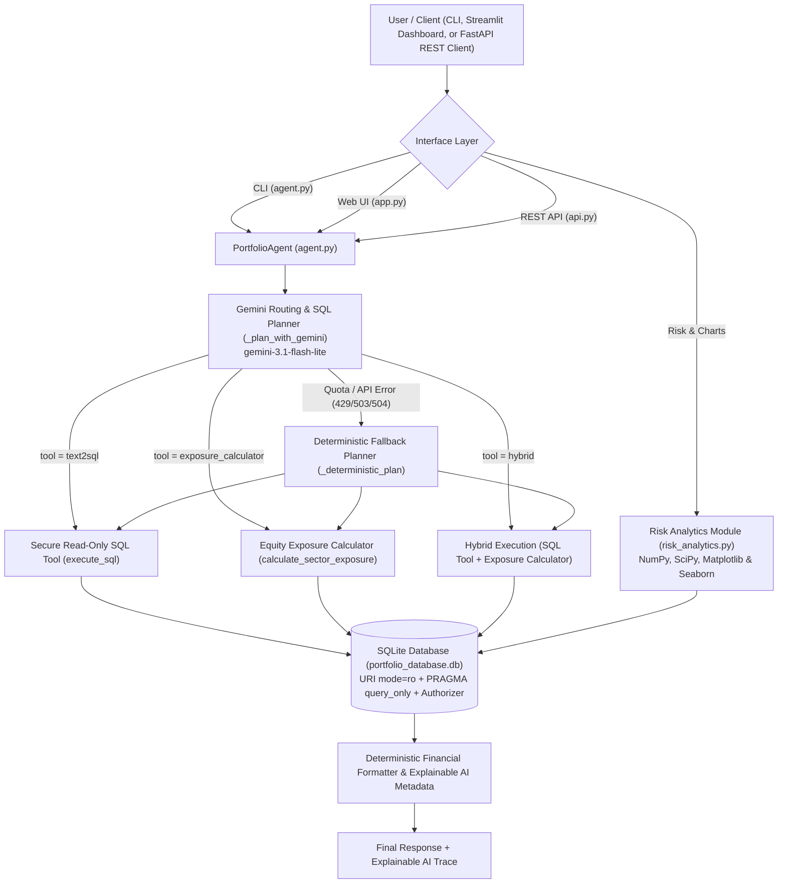

# AI Portfolio Analytics Agent

A conversational AI, statistical risk analytics, and REST/Streamlit analytics system for querying investment portfolios, holdings, securities, sectors, performance, and risk metrics from a relational SQLite database (`portfolio_database.db`), powered by the Google Gemini API (`google-genai`, `gemini-3.1-flash-lite`) with 4-layer read-only SQLite security and deterministic fallback.

---

## 1. Architecture & Overview



---

## 2. Folder Structure

```text
PL_AiPortfolioAgent/
├── data/
│   ├── benchmarks.csv
│   ├── historical_prices.csv
│   ├── holdings.csv
│   ├── portfolio_performance.csv
│   ├── portfolios.csv
│   ├── risk_metrics.csv
│   ├── sectors.csv
│   ├── securities.csv
│   └── transactions.csv
├── agent.py                             # Core PortfolioAgent (CLI, Gemini routing, SQL tool, hybrid & fallback routing)
├── exposure_tool.py                     # Equity sector exposure calculator & portfolio name resolver
├── risk_analytics.py                    # Statistical risk & concentration module (NumPy, SciPy, Matplotlib, Seaborn)
├── api.py                               # FastAPI REST API server (Uvicorn ASGI)
├── api_schemas.py                       # Pydantic request/response schemas for the REST API
├── app.py                               # Interactive Streamlit portfolio analytics dashboard with Explainable AI
├── database.py                          # SQLite database initialization and verification script
├── evaluator.py                         # Ground-truth evaluation script + verification suite
├── test_agent.py                        # Automated pytest + HTTPX + Streamlit AppTest suite (14 tests)
├── database_schema.sql                  # Relational schema (9 tables, foreign keys, and 18 custom indices)
├── ground_truth_dataset.json            # 10 reference evaluation questions (8 text2sql, 2 exposure_calculator)
├── evaluation_report.json               # Generated evaluation report with pass/fail metrics
├── portfolio_database.db                # Populated SQLite database (603 total records across 9 tables)
├── requirements.txt                     # Python package dependencies (all 13 packages used)
├── DEPENDENCY_FEATURE_VERIFICATION.md   # Verification matrix mapping every dependency to files, features, and tests
├── FINAL_AUDIT_REPORT.md                # End-to-end audit report
├── .env.example                         # Template for environment variables
└── .gitignore                           # Excludes .env, .venv/, and __pycache__/
```

---

## 3. Features & Tools Implemented

1. **SQL Query Tool (`PortfolioAgent.execute_sql` in `agent.py`)**:
   - Converts natural-language portfolio questions into read-only SQLite `SELECT` or `WITH ... SELECT` queries using the full schema from `database_schema.sql`.
2. **Sector Exposure Calculator (`calculate_sector_exposure` & `resolve_portfolio_name` in `exposure_tool.py`)**:
   - Calculates percentage sector exposures across equity (`asset_type = 'Stock'`) holdings only, excluding bonds.
   - Supports exact case-insensitive matching, unique partial matching (e.g., `"international equity"` → `"International Equity Fund"`), and ambiguity detection (e.g., `"Equity"` lists matching portfolios without guessing).
3. **Hybrid Analytics (`tool = "hybrid"` in `agent.py`)**:
   - Resolves the target portfolio, retrieves `total_aum` via `execute_sql()`, calculates equity sector exposures via `calculate_sector_exposure()`, and combines both into a structured natural-language response with full tool metadata (`tools_used`, `portfolio_identified`, `aum_result`, `sector_exposure_result`, `execution_status`).
4. **Statistical Risk & Concentration Analytics (`risk_analytics.py`)**:
   - **NumPy**: Computes Herfindahl-Hirschman Index (`HHI`), effective number of holdings (`1 / HHI`), holding weight dispersion, and weighted daily return averages/volatilities from `holdings` and `historical_prices`.
   - **SciPy (`scipy.stats`)**: Computes return skewness, kurtosis, Shapiro-Wilk normality p-values, parametric 95% daily VaR (`stats.norm.ppf`), and pairwise Pearson correlations (`stats.pearsonr`) while clearly separating calculated metrics from recorded database rows (`portfolio_performance` and `risk_metrics`).
   - **Matplotlib & Seaborn**: Renders multi-panel Risk-Return scatter plots, recorded NAV trajectories, equity sector exposure heatmaps (`sns.heatmap`), and NAV return correlation heatmaps.
5. **Streamlit Dashboard (`app.py`)**:
   - 5 tabs: Active Portfolio Overview, Sector Allocation, Risk & Concentration Analysis (with NumPy/SciPy tables and Matplotlib/Seaborn figures), Portfolio Comparison, and Conversational AI Agent with the `"How This Answer Was Generated"` expander (`expanded=False` by default).
6. **FastAPI REST API (`api.py` & `api_schemas.py`)**:
   - Independent REST API powered by FastAPI, Pydantic v2 validation, and Uvicorn ASGI server, reusing the read-only `PortfolioAgent`, `exposure_tool`, and `risk_analytics` modules.

---

## 4. Installation & `.env` Configuration

### Step 1: Create Virtual Environment & Install Dependencies
Open PowerShell in `c:\Users\HP\OneDrive\Desktop\PL_AiPortfolioAgent`:

```powershell
python -m venv .venv
.\.venv\Scripts\python.exe -m pip install -r requirements.txt
```

### Step 2: Configure `.env`
Copy `.env.example` to `.env` or set your `GEMINI_API_KEY` securely in PowerShell:

```powershell
$sec = Read-Host "Enter GEMINI_API_KEY (typing hidden)" -AsSecureString; $val = [Runtime.InteropServices.Marshal]::PtrToStringAuto([Runtime.InteropServices.Marshal]::SecureStringToBSTR($sec)); Add-Content -Path ".env" -Value "GEMINI_API_KEY=$val"; Write-Host "Saved."
```

Environment variables supported in `.env`:
- `GEMINI_API_KEY`: Your Google AI Studio API key.
- `GEMINI_MODEL`: Defaults to `gemini-3.1-flash-lite`.

### Step 3: Initialize / Verify the SQLite Database
```powershell
.\.venv\Scripts\python.exe database.py
```

---

## 5. Launching the Applications (Run in Separate Terminals)

### A. Command-Line Interface (CLI)
```powershell
# Interactive REPL loop (supports 'help', 'details', 'exit')
.\.venv\Scripts\python.exe agent.py

# Single-question CLI mode with metadata details
.\.venv\Scripts\python.exe agent.py "Show me the AUM and sector exposure of Growth Equity Fund." --details
```

### B. Streamlit Dashboard
```powershell
.\.venv\Scripts\python.exe -m streamlit run app.py
```

### C. FastAPI REST API Server (Uvicorn)
Run in a separate terminal from Streamlit:
```powershell
.\.venv\Scripts\python.exe -m uvicorn api:app --host 127.0.0.1 --port 8000
```

---

## 6. REST API Endpoint Documentation (`api.py`)

When Uvicorn is running on `http://127.0.0.1:8000` (Interactive OpenAPI docs available at `http://127.0.0.1:8000/docs`):

| Method & Path | Description | Example Request (PowerShell / `curl`) |
| :--- | :--- | :--- |
| `GET /health` | API and read-only SQLite database health check | `Invoke-RestMethod http://127.0.0.1:8000/health` |
| `GET /portfolios` | List all 13 portfolios with AUM, risk level, and status | `Invoke-RestMethod http://127.0.0.1:8000/portfolios` |
| `GET /portfolios/{portfolio_name}` | Portfolio details, AUM, holdings count, and market value | `Invoke-RestMethod "http://127.0.0.1:8000/portfolios/Growth%20Equity%20Fund"` |
| `GET /portfolios/{portfolio_name}/exposure` | Equity sector exposure breakdown (excluding bonds) | `Invoke-RestMethod "http://127.0.0.1:8000/portfolios/international%20equity/exposure"` |
| `GET /portfolios/{portfolio_name}/analytics` | Combined AUM, sector exposures, NumPy/SciPy calculated stats, and recorded DB risk metrics | `Invoke-RestMethod "http://127.0.0.1:8000/portfolios/Tech%20Innovation%20Fund/analytics"` |
| `POST /agent/query` | Submit a natural-language question to `PortfolioAgent` | `Invoke-RestMethod -Method Post -Uri http://127.0.0.1:8000/agent/query -ContentType "application/json" -Body '{"question": "Show me the AUM and sector exposure of Growth Equity Fund."}'` |

---

## 7. Testing & Evaluation Commands

```powershell
# 1. Run Ground-Truth Evaluator (10/10 ground-truth questions + 7 verification checks, 0 live API calls)
.\.venv\Scripts\python.exe evaluator.py

# 2. Run Full Pytest Suite (14/14 tests covering Agent, SQL Security, Streamlit AppTest, Risk Analytics, and FastAPI/HTTPX)
.\.venv\Scripts\python.exe -m pytest -v
```
